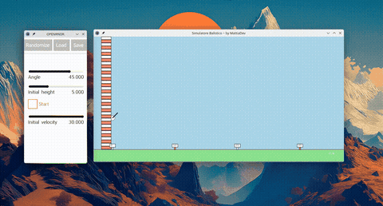
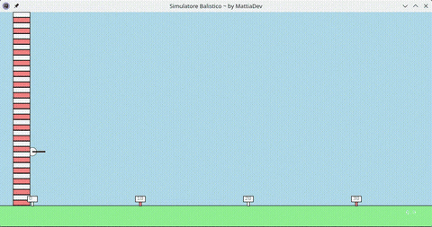
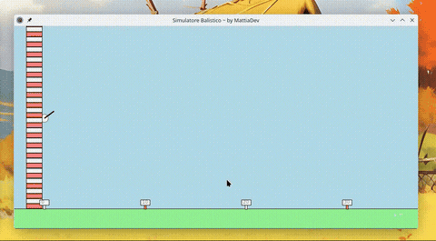
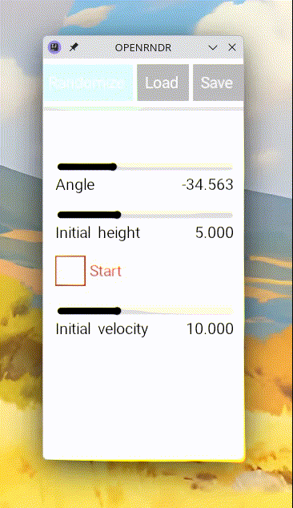
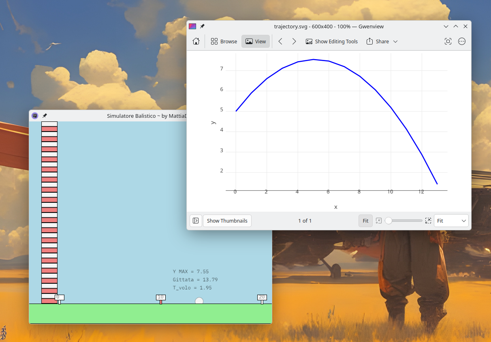
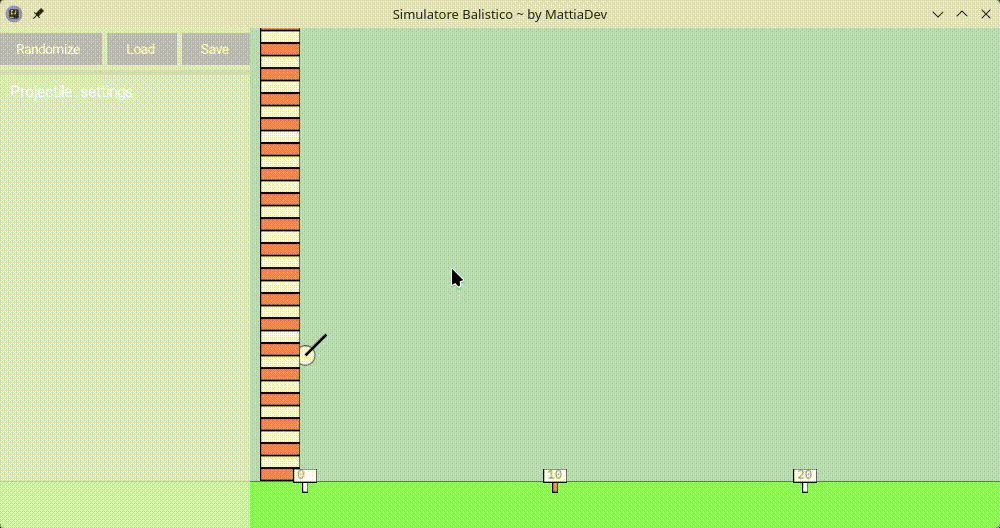

# Simulatore Balistico
Un Simulatore di moto parabolico scritto in Kotlin con OPENRNDR cercando di imitare lo stile giocoso di WII Sport mantenendo l'interfaccia di una strumentazione scientifica.

## Features
1. Simula il lancio di un corpo con diversi parametri iniziali
   
2. Muovi la camera per osservare meglio ogni lancio
   
3. Cambia velocemente i parametri \
   
4. Genera il grafico della traiettoria in automatico
   
5. Salva i parametri per ripetere i test

### Work in progres
- UI: Creare una nuova ui personalizzata per i parametri e migliorare l'estetica della mappa
- OOP: Ottimizzare il codice, migliorare l'accuratezza e migrare a programmazione a oggetti per una migliore chiarezza
- Risolvere i bug nella generazione di grafici 

### Credits

This project has been made possible thanks to [OPENRNDR](https://guide.openrndr.org/), if you are into kotlin I suggest you to try this library, it's an amazing tool to make these kind of projects because it is simple to use and allows you to quickly create visualizations and animations while still leaving space for customization.
